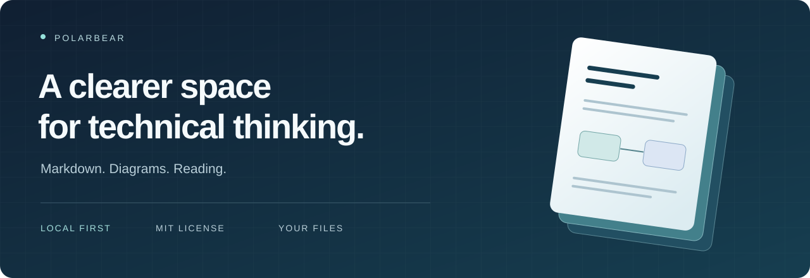
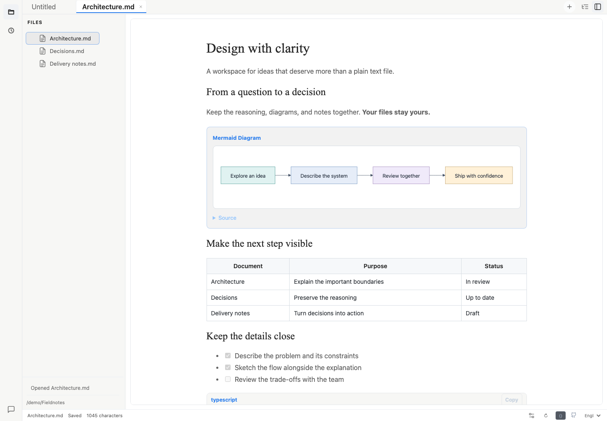
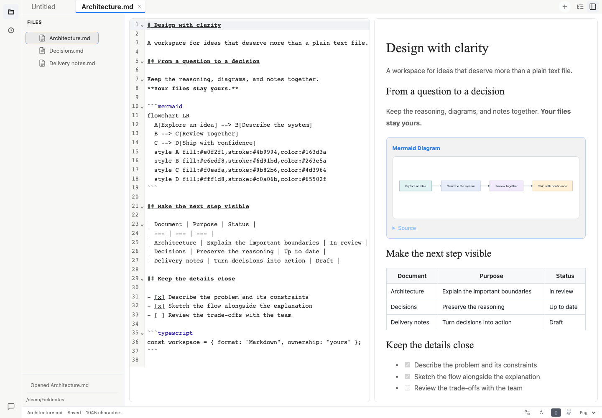
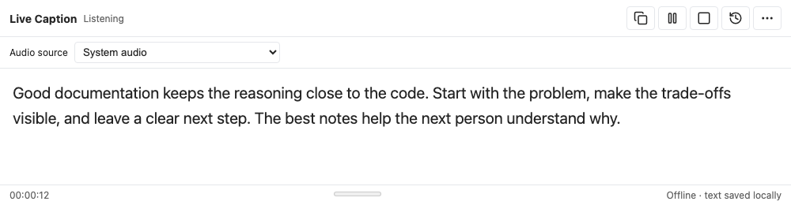

<p align="center">
  
</p>

<p align="center">
  <strong>A local-first Markdown workspace for people who write, build, and learn.</strong>
</p>

<p align="center">
  <a href="https://github.com/smartscity/polarbear/releases">Releases</a> ·
  <a href="#what-you-can-do">Capabilities</a> ·
  <a href="#get-started">Get started</a> ·
  <a href="docs/README.md">Documentation</a> ·
  <a href="CONTRIBUTING.md">Contribute</a>
</p>

Polarbear brings technical writing, diagrams, repository workflows, and offline
reading tools into one desktop workspace. Turn an engineering note into a readable
document, explore a large architecture diagram, or translate an English passage
without leaving your work.

Your documents stay ordinary Markdown files. Work locally, organize them in
folders, and connect GitHub or GitLab when you want repository synchronization.
Built with **Rust, Tauri, React, and TypeScript**.

<p align="center">
  
  <br><sub>One document. The explanation, the diagram, and the next steps.</sub>
</p>

## What you can do

| Your work | What Polarbear brings |
| --- | --- |
| **Write a specification** | Source editing, live editing, split view, and reading preview, with tables, code blocks, task lists, and images. |
| **Explain a system** | Mermaid diagrams rendered in the document, a zoomable diagram viewer, and SVG/PNG export. PlantUML rendering is available with explicit remote-render consent. |
| **Navigate a knowledge base** | Folder workspaces, a file tree, multiple tabs, document outlines, and native recent-file menus. |
| **Read across languages** | Bundled offline English-to-Chinese translation; local Vocab integration on macOS for dictionary information and vocabulary favorites. |
| **Keep documentation in a repository** | GitHub/GitLab file browsing and workspace sync, including uploads, downloads, deletions, and conflict checks, without a local Git installation. |
| **Share finished work** | Rich document copy with text, tables, and Mermaid images, explicit Markdown-source copy, and standalone diagram export. |

### Write with the source always within reach

Switch between Markdown source, live editing, split view, and preview as the task
changes. Use the outline to move through longer documents and tabs to keep related
notes open. Light and dark themes, zoom controls, and English/Chinese interface
resources let you adapt the workspace to your reading and writing preferences.

Unsaved-change prompts and revision checks help protect edits when closing a
document or saving over a file that changed on disk.



<p align="center"><sub>Stay close to the source. See the result as you write.</sub></p>

### Give technical ideas room to breathe

Keep diagrams alongside the text that explains them. Mermaid supports workflows,
sequence diagrams, state machines, entity relationships, Gantt schedules, and more.
Open larger diagrams in the viewer to zoom and pan, then export SVG or PNG for
presentations and other documents.

Mermaid renders locally. **PlantUML uses a remote rendering service only after
approval**; its source is sent to that service. Choose Mermaid for diagrams that
need to stay on the device.

### Read, understand, and keep useful vocabulary

Select English text for Chinese translation using the bundled Bergamot engine and
model assets. Desktop translation needs no first-use model download, Apple
language pack, or cloud fallback.

On macOS, the separate local **Vocab** application supplies dictionary senses,
available IPA, and vocabulary favorites. Translation works independently of Vocab;
dictionary information and favorite delivery require that integration.

[Reading tools and platform details →](docs/planning/desktop-vocab-reading.md)

### Connect documents to your repository

Associate a workspace with a GitHub or GitLab repository and remote directory.
Review and synchronize local and remote changes through provider APIs. Conditional
publication checks detect conflicting repository updates rather than silently
overwriting them. Release builds store access tokens in the platform credential
store.

Rich copy helps move a document into another writing tool while keeping Markdown
source available as a separate action. Receiving applications determine paste
fidelity; Word/Lark mixed-content acceptance remains unverified. Complete-document
PDF and HTML export are not currently available.

[Rich document copy →](docs/planning/desktop-rich-document-copy.md)

## Beyond the editor

These capabilities have their own platform requirements and acceptance boundaries.

### Live Caption · macOS preview



Capture **system audio or microphone input** on macOS 13+ and transcribe English
locally with bundled recognition assets. The live panel displays confirmed text
and follows new captions automatically. Chinese translation is an explicit opt-in;
local history, copy, and TXT/Markdown/SRT export support later review.

Capture starts through an explicit user action and requires OS permissions.
Diagnostic audio recording is separately opt-in. Combined system-and-microphone
capture with echo cancellation is not implemented. Recognition accuracy and
long-session stability remain under qualification; this is a preview feature.

[Implementation, validation, and remaining gates →](docs/planning/live-caption-implementation.md)

### Memory & context · experimental integration

Inspect and edit Memory records and history through the separate Polarbear Memory
Engine's versioned Admin API. The Engine owns storage; Desktop provides the
interface. This is an integration under development, with a separately configured
Engine, not a built-in general-purpose agent chat host.

The recorded M1 evaluation requires revision and does not establish rollout
readiness or task-level token savings.

[Memory design and evaluation →](docs/planning/desktop-memory-context-design.md)

### iPhone reader · experimental companion

The separate iPhone application imports document snapshots for reading, with
installed-model Apple translation, speech, and system dictionary tools. It is a
read-only companion under development. Signed-device distribution and provider
acceptance remain separate gates; linked editing and iCloud sync are not delivered.

[iPhone reader guide →](apps/ios/README.md)

## Get started

Browse [GitHub Releases](https://github.com/smartscity/polarbear/releases) for
published installers and the notes attached to each version.

| Platform | Distribution target | Scope |
| --- | --- | --- |
| **macOS** | Universal `.dmg` for Apple Silicon and Intel | Desktop workspace; Live Caption preview requires macOS 13+. |
| **Windows** | x64 NSIS `.exe` installer | Desktop workspace; macOS audio capture and Vocab integration do not carry over. |
| **iPhone** | Separate development workspace | Experimental reader; no App Store distribution claim. |
| **Linux / Android** | No release installer in the current workflow | Not current distribution targets. |

The release workflow prepares **draft releases**. An installer build does not by
itself establish publication, signing/notarization, or installed-device acceptance.
Check the selected release's notes and [verification records](docs/engineering/verification.md)
for its exact scope.

1. Install the package for your platform from a published release.
2. Open a Markdown file or a folder workspace.
3. Choose your editing or reading view and start working.
4. Configure repository sync or the optional integrations when you need them.

## Local work, explicit connections

- **Portable documents.** Markdown files remain on your filesystem and usable by other tools.
- **Offline translation.** Desktop English-to-Chinese inference uses bundled assets.
- **Local Mermaid rendering.** Diagram rendering does not require a server.
- **Optional network workflows.** Repository sync connects to the selected provider; PlantUML requires explicit approval before sending diagram source remotely. Documents can also reference remote images.
- **Separate integration ownership.** Vocab and Memory are independent local services; Desktop does not directly access Memory's database.

<sub>Images show the current frontend with synthetic demo documents and caption
text. Native file/audio calls are simulated for capture; these images illustrate
the interface, not installed-app or recognition acceptance.
[Image provenance and reproduction](docs/assets/README.md).</sub>

## Build from source

Install Node.js LTS, npm, Rust stable, and the Tauri v2 prerequisites for your
platform. macOS native development also requires Xcode Command Line Tools.

```bash
npm ci
npm run tauri:dev
```

For a frontend-only development session:

```bash
npm --workspace apps/desktop run dev
```

Build the frontend or package the native desktop app:

```bash
npm run build
npm run tauri:build
```

Root scripts target Desktop. The [iPhone guide](apps/ios/README.md) covers the
reader's separate workspace, Xcode setup, and simulator commands.

| Explore the project | Start here |
| --- | --- |
| Development rules and checks | [Contributing](CONTRIBUTING.md) |
| Application structure and boundaries | [Architecture](ARCHITECTURE.md) |
| Feature guides, plans, and evidence | [Documentation index](docs/README.md) |
| Native and platform acceptance | [Engineering verification](docs/engineering/verification.md) |
| Packaging and candidate checks | [Release workflow](.github/workflows/release.yml) |
| Report a problem or propose an improvement | [GitHub Issues](https://github.com/smartscity/polarbear/issues) |

## License

Polarbear is available under **[MIT](LICENSE-MIT)**. Bundled dependencies, translation models, and caption assets retain
their own licenses and notices; see the [translation asset notices](apps/desktop/public/models/en-zh/README.md)
and [caption asset documentation](apps/desktop/src-tauri/resources/caption/README.md).
