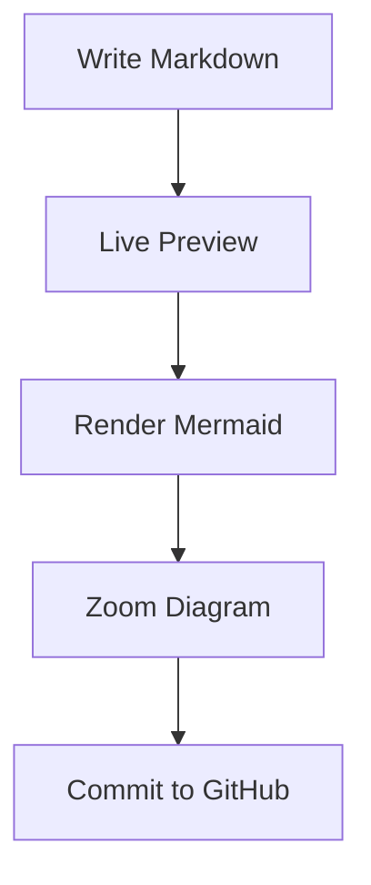

# Polarbear

[English](README.md) | [简体中文](README-zh.md) | [Documentation index](docs/README.md) | [v0.9.3 status](docs/releases/v0.9.3.md)

> A local-first Markdown editor for writers, developers, and GitHub-based knowledge workflows.

Polarbear is an open-source, local-first Markdown editor built with Rust, Tauri, and TypeScript.  
It focuses on clean writing, live preview, Mermaid and PlantUML diagrams, and GitHub/GitLab document workflows.

Current platform status (verified against v0.9.3, 2026-10-14):

- macOS desktop app: universal DMG built successfully
- Windows desktop app: x64 NSIS installer built successfully
- iPhone: separate experimental, read-only Tauri/React reader in `apps/ios`, with native document import and reading tools; signed-device distribution remains unverified

The existing v0.9.3 tag identifies commit `66eec710`. Release, Desktop Quality and
iPhone Reader Quality workflows passed for that commit. The release workflow
intentionally creates a draft release; successful packaging does not establish
installed-device acceptance. See [the verification record](docs/releases/v0.9.3.md)
for evidence, current limits and the distinction between recorded passes and
checks without a recorded pass.

---

## Why Polarbear?

Polarbear is designed for people who write technical documents, engineering notes, product specs, architecture diagrams, and GitHub-based knowledge bases.

It is not just another Markdown editor.  
It aims to become a local-first writing workspace with:

- Fast native experience powered by Rust and Tauri
- Clean Markdown editing and live preview
- First-class Mermaid diagram support
- Zoomable diagram viewer
- GitHub and GitLab Cloud Sync
- Clear architecture for long-term open-source maintenance

Write locally. Preview clearly. Sync when needed.

Desktop and the experimental iPhone reader are separate applications. The reader is not a mobile editor or a published App Store product. Platform-specific behavior stays behind adapters so portable code remains reusable without importing Desktop services into the reader.

---

## Features

### Markdown Editing

- Open local Markdown files
- Edit Markdown with a clean editor
- Live preview
- Split view: editor and preview side by side
- Preview-only mode
- Editor-only mode
- Unsaved change indicator
- Local file access designed with desktop permissions and iOS sandbox limitations in mind

### Diagram Support

- Render Mermaid code blocks inside Markdown preview
- Open Mermaid diagrams in a zoomable viewer
- Zoom in, zoom out, reset zoom
- Drag and pan large diagrams
- Copy Mermaid source
- Export SVG
- Export Mermaid and PlantUML diagrams as SVG or PNG
- Keep Mermaid rendering in the WebView layer; the iPhone reader reuses the pure rendering modules

### Cloud Sync

- Connect to a GitHub or GitLab repository
- Browse Markdown files from a repository
- Read remote Markdown files
- Edit and commit changes back to the selected provider
- Sync through provider REST APIs without requiring a local Git installation
- Use commit messages such as:

```text
docs: update {file_path}
```

### Reading and Vocabulary

- Desktop English-to-Chinese translation uses bundled Bergamot 0.4.9 and verified model assets, with no first-run model download, Apple language-pack requirement or cloud fallback
- Selection reading supports cancellation, rapid reselection and a persistent opt-out
- Dictionary senses, available IPA and vocabulary membership come from Vocab; neural translation is not authoritative dictionary data
- macOS Vocab integration uses the existing local protocol, with a durable background favorite queue and source-context opt-out
- The iPhone reader has its own installed-only Apple translation path, speech, system dictionary and explicit offline capture-file handoff

See [Desktop reading](docs/planning/desktop-vocab-reading.md) and
[iPhone reading](docs/planning/iphone-reading-assistant.md) for platform limits.
Production Chromium/WebKit inference has passed; actual installed DMG/Tauri
WebView and older-macOS/Windows-device acceptance have no recorded pass yet.

### Rich Document Copy

- Whole-document copy can carry readable text, rich HTML and Mermaid images while retaining a separate Markdown flavor
- Copy Markdown Source explicitly preserves raw Markdown
- macOS native rich-text receiver checks cover table structure and multiple Mermaid images
- Mixed text/table/Mermaid paste into Lark and Word has no recorded acceptance pass; receiver behavior must be checked separately

See [rich document copy](docs/planning/desktop-rich-document-copy.md).

### Extensibility

Mermaid, PlantUML, Cloud Sync, and export are built-in features with explicit module boundaries. Polarbear does not currently expose a runtime plugin API. A plugin system will only be considered after permissions, versioned contracts, and sandboxing are designed.

---

## Tech Stack

- Rust
- Tauri v2 with mobile compatibility
- React
- TypeScript
- Vite
- CodeMirror 6
- Mermaid
- GitHub and GitLab REST APIs

---

## Project Structure

```text
polarbear/
  Cargo.toml
  Cargo.lock
  package.json
  package-lock.json
  README.md
  README-zh.md
  ARCHITECTURE.md
  apps/
    desktop/
      package.json
      src/
        app/
        commands/
        features/
        shared/
      src-tauri/
        Cargo.toml
    ios/
      package.json
      src/
      src-tauri/
        reader-plugin/
  packages/
    reader-core/
    apple-document-store/
  docs/
    README.md
    planning/
    releases/
```

`apps/desktop/src-tauri` is the only member of the root Cargo workspace.
`apps/ios/src-tauri` has a separate Cargo workspace and native reader plugin.
Root npm scripts target Desktop; use explicit `apps/ios` workspace scripts for
the reader. `packages/reader-core` holds portable reader logic, while
`packages/apple-document-store` contains a shared native linked-document
foundation whose user-facing editing/sync integration is not yet delivered.

The repository does not contain a separate `CONTRIBUTING.md` or root project
license-text files. Cargo declares `MIT OR Apache-2.0`; bundled translation assets
have their own included third-party license notices.

---

## Architecture Principles

Polarbear follows these principles:

- Local-first by default
- Feature-oriented TypeScript UI with a typed Tauri boundary
- Desktop-first delivery with portable feature boundaries
- Clear module boundaries
- Built-in feature modules with explicit ownership
- Thin Tauri command entry points backed by focused Rust services
- Domain models separated from DTOs
- Testable core logic
- Explicit error handling
- No token leakage in logs
- Platform-specific logic behind traits or adapter modules
- macOS-only APIs isolated in platform modules
- Small, meaningful modules
- Descriptive naming

---

## Platform Support

Desktop packaging targets macOS and Windows; the iPhone reader is an experimental development target.

Supported release targets:

- macOS
- Windows

Experimental target:

- iPhone reader, with a dedicated workspace, simulator checks and browser preview; physical-device/provider acceptance and signed distribution remain separate gates

Future targets:

- Linux
- Android

Platform rules:

- Use Tauri v2 and keep mobile compatibility in mind.
- Keep UI responsive across desktop and mobile screen sizes.
- Keep macOS-only APIs isolated from portable command and service logic.
- Put platform-specific behavior behind traits or adapter modules.
- Keep Tauri commands thin and free of platform-specific business logic.
- Use provider REST APIs for sync so repository workflows do not depend on a local Git executable.
- Treat local file access as capability-based; the iPhone reader imports authorized snapshots inside its app sandbox.
- Keep Mermaid rendering in the WebView layer.
- Avoid dynamic native plugin loading for the MVP.

---

## Rust Code Style

Rust code should follow idiomatic naming conventions:

- Types, traits, and enums use `UpperCamelCase`
- Functions, methods, variables, and modules use `snake_case`
- Constants use `SCREAMING_SNAKE_CASE`
- Avoid unclear names such as `handle`, `process`, `data`, `info`, `manager`
- Prefer meaningful names such as:

  - `CloudSyncStore`
  - `RepositorySettings`
  - `SecretStoreError`
  - `WorkspaceFile`

Do not use `unwrap()` or `expect()` in production code.
Use explicit error types and return meaningful errors.

---

## Development

### Prerequisites

- Rust stable
- Node.js LTS
- npm (the committed lockfile is `package-lock.json`)
- Tauri v2 prerequisites for the platform being built
- Xcode Command Line Tools for macOS development

### Install Dependencies

For a clean checkout, install the exact versions from the committed lockfile:

```bash
npm ci
```

Use `npm install` only when intentionally updating dependencies and the lockfile. Rust dependencies are resolved by Cargo when a Rust or Tauri command runs.

### Run macOS App

```bash
npm run tauri:dev
```

This starts Vite on `127.0.0.1:1420`, compiles the Rust crate, and opens the Tauri desktop app.

You can also run the workspace script directly:

```bash
npm --workspace apps/desktop run tauri -- dev
```

The `tauri:dev` alias is defined at the repository root. There is no script with that name inside `apps/desktop/package.json`; the direct workspace form must use `run tauri -- dev` as shown above.

### iOS Status

Use the separate reader workspace rather than running Desktop's Tauri script
with an iOS subcommand:

```bash
npm --workspace apps/ios run dev
npm --workspace apps/ios run ios:init -- --ci
npm --workspace apps/ios run ios:dev
```

The browser preview runs on port 1430. Native development requires Xcode and the
iOS prerequisites; generated Xcode files and signing credentials are local build
outputs, not committed source. See [the reader guide](apps/ios/README.md) for
simulator commands, checks, device setup and known limitations.

### Build Rust Workspace

```bash
cargo build --workspace
```

### Build Release Binary

```bash
cargo build --workspace --release
```

The release binary is generated under:

```text
target/release/
```

### Build Desktop Frontend

```bash
npm run build
```

The frontend bundle is generated under:

```text
apps/desktop/dist/
```

### Package macOS App

```bash
npm run tauri:build
```

This creates the configured native packages through Tauri.

Expected package outputs are generated under the Tauri target directory, commonly:

```text
target/release/bundle/
```

For macOS, expected artifacts may include `.app` and `.dmg` packages depending on the Tauri bundler configuration.

### Install Locally

For development, run the app directly:

```bash
npm run tauri:dev
```

For local installation on macOS after packaging:

1. Build the app with `npm run tauri:build`.
2. Open the generated `.dmg` or `.app` from the bundle output directory.
3. Move `Polarbear.app` to `/Applications`.

### Mobile Notes

The reader already has a native Tauri entry point and iOS plugin. It uses immutable imports, sandboxed document access and WebView rendering. Generating its local Xcode project is a development setup step; a working browser preview or simulator build does not establish physical-device, provider or signed-distribution acceptance.

### Run Rust Checks

```bash
cargo fmt --all -- --check
cargo clippy --workspace --all-targets --all-features -- -D warnings
cargo test --workspace
```

### Run Frontend Checks

```bash
npm run lint
npm run typecheck
npm test
npm run build
npm --workspace apps/desktop run test:translation-assets
npm exec --workspace apps/desktop -- playwright install chromium webkit
npm --workspace apps/desktop run test:offline-translation -- --webkit
npm --workspace apps/desktop run test:ui
```

The native clipboard receiver check runs on macOS:

```bash
npm --workspace apps/desktop run test:native-clipboard
```

These commands describe checks to run. Their inclusion is not a claim that they
were rerun for a documentation-only change. Recorded v0.9.3 results and remaining
manual checks are in [the status page](docs/releases/v0.9.3.md).

### Release Packaging

The [release workflow](.github/workflows/release.yml) runs for `v*` tags or an
explicit existing desktop release tag supplied through manual dispatch. It builds
a universal macOS DMG and a Windows x64 NSIS installer, uploads the DMG as an
Actions artifact, and attaches both installers to a draft GitHub Release.
Publication is a separate action. `ios-v*` milestones use the independent iPhone
quality workflow and do not trigger Desktop packaging.

Release builds derive the app version from the selected tag and update build-local
JSON metadata. Source manifest versions do not by themselves identify the packaged
release. A documentation-only correction does not require changing versions,
rebuilding artifacts or moving an existing tag.

---

## Cloud Sync Token

Polarbear uses a GitHub or GitLab personal access token to synchronize workspace files.

Security rules:

- Do not store tokens in plain text configuration files
- Do not print tokens in logs
- Token access must go through the Rust `secret_store` module
- Release builds require the platform Keychain
- Plaintext fallback storage is limited to debug builds

---

## Mermaid Example



---

## Roadmap

### Current gaps

- Complete physical-iPhone/provider acceptance and signed distribution for the experimental reader
- Record installed Desktop/Tauri WebView acceptance and receiver-specific Lark/Word rich-paste results
- Integrate the shared Apple document foundation before claiming linked cross-device editing or iCloud synchronization
- Export complete documents to PDF and HTML
- Continue extracting workspace, repository sync, and export services from the large Tauri entry point
- Expand integration coverage around native commands and release packaging

### Future

- AI-assisted writing
- GitHub Pull Request editing
- Team knowledge base mode
- Document publishing
- Custom plugin marketplace

---

## License

Cargo manifests declare `MIT OR Apache-2.0`; corresponding root project license-text files are still absent. Bundled Bergamot/model MPL-2.0 notices and the fflate MIT notice are separate third-party notices and do not replace the project license texts. See [the bundled asset notice](apps/desktop/public/models/en-zh/README.md).
