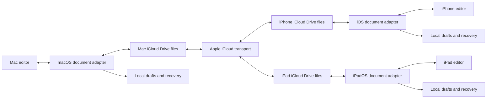

# Polarbear Markdown editing and iCloud synchronization

Status: Implementation started; native foundation only, not feature-complete.
Scope: Markdown editing and synchronization on
macOS, iPhone, and iPad, using the same Apple Account with iCloud Drive enabled.

Use a user-selected iCloud Drive folder as the authoritative document location.
Polarbear edits ordinary Markdown files in that folder. Apple manages transport
between devices; Polarbear manages authorized file access, durable editing,
external changes, offline recovery, and conflict resolution. All three clients
must support editing before this feature is considered complete.

## Implementation checkpoint: native foundation

`packages/apple-document-store` now contains the shared Foundation implementation
for native folder bookmarks, scoped access, bounded Markdown reads/listing,
SHA-256 revisions, coordinated compare-and-replace, generation-checked local
drafts, explicit restart recovery, and preservation of conflicting versions.
The Desktop Swift build and the iOS plugin package include the same sources.
The native regression suite is included in the iPhone Reader quality workflow.
The first checkpoint passed 29 native regression tests, the existing Reader
storage tests, Desktop and iOS simulator-target native compile checks, and an
arm64 iOS 16 SDK typecheck. Physical iCloud acceptance remains unverified.

This is part of Stage 1 and some persistence groundwork for Stage 2, not completion
of either stage. Neither application routes its user-facing editing workflow to
this store yet. Mobile remains a Viewer, existing imported collections remain
immutable, and Desktop's existing local save path has not been replaced.

Still required before enabling linked editing: the native picker/IPC adapters,
transport-policy checks, shared TypeScript document contract, presenter lifecycle,
provider cancellation/status, create/rename/delete operations, mobile editor,
conflict/recovery UI, and physical-device acceptance. Native test failures are
injected locally; no iCloud account or real user documents are used by the tests.
The package currently serializes operations per store and requires one native
owner per private storage root. It does not yet implement cross-process journal
ownership or automatic history cleanup. Do not advertise synchronization or
change the mobile document role until the remaining release gates pass.

See [the package boundary and validation notes](../../packages/apple-document-store/README.md).

## Current implementation

The current working tree provides useful parts of this design, but does not yet
provide this workflow:

| Area | Current behavior | Required change |
| --- | --- | --- |
| Desktop saves | `save_markdown_file_content` checks an optional content revision, then calls `atomic_write` | Coordinate provider-backed access and perform the revision check inside the coordinated write |
| Desktop refresh | `useWorkspaceDocumentRevision` polls file metadata; `useWorkspaceFileTreeRefresh` also refreshes on focus | Add native change events and reconcile content on resume, retaining bounded polling as a fallback |
| Mobile selection | `ReaderPlugin` already uses a document picker with `asCopy: false` | Persist the selected directory grant and establish an editable workspace |
| Mobile storage | `ReaderLibrary` immediately copies the selection into an immutable private collection | Add linked workspaces alongside existing imported collections |
| Mobile document delivery | `Info.ios.plist` declares a Markdown viewer and disables opening in place | Declare editing support after the native write path and recovery UI are available |
| Mobile UI | The application is a read-only Reader | Add a Markdown editor, save state, recovery, and conflict UI for iPhone and iPad |

Relevant source locations are
[`main.rs`](../../apps/desktop/src-tauri/src/main.rs),
[`ReaderPlugin.swift`](../../apps/ios/src-tauri/reader-plugin/ios/Sources/ReaderPlugin.swift),
[`ReaderLibrary.swift`](../../apps/ios/src-tauri/reader-plugin/ios/Sources/ReaderLibrary.swift),
[`library.ts`](../../apps/ios/src/library/library.ts), and
[`Info.ios.plist`](../../apps/ios/src-tauri/Info.ios.plist).

Selecting a file with `asCopy: false` does not establish synchronization by itself:
the current application subsequently makes its own snapshot and drops the source
access grant.

## User workflow

1. The user creates or selects a folder such as `iCloud Drive/Polarbear` on Mac and
   opens it as an iCloud workspace in Polarbear.
2. On iPhone and iPad, the user chooses **Connect folder** and selects that same
   folder through the system Files picker. Each device obtains its own grant.
3. The user opens, creates, and edits `.md` or `.markdown` documents on any device.
   Edits save automatically, with an explicit save action also available.
4. Other devices reconcile their provider files when active or resumed. Clean
   documents reload; documents with local edits enter conflict handling.
5. Downloaded documents remain editable offline. A document whose contents have
   never been downloaded shows an availability message instead of an empty editor.

This uses the system document provider chosen by the user. It does not require a
Polarbear account, a custom sync server, a CloudKit record schema, or an app-owned
iCloud container. An app-owned container would be a separate onboarding choice.
The supported cloud provider for this release is iCloud Drive; other Files
providers require their own acceptance tests before being advertised.

## Storage and responsibilities



The selected folder contains Markdown and any existing relative image assets.
Bookmarks, workspace identifiers, edit journals, revision baselines, indexes,
and reading preferences remain in each device's Application Support directory.
Bookmarks and absolute paths are device-local and must never be synchronized.
Each device selects the same cloud folder independently; a globally shared
workspace identifier is unnecessary for this release.

Existing Reader snapshots remain separate imported collections. Converting one
to an editable workspace requires selecting a source folder or explicitly
exporting its files. A historical import does not establish a persistent grant.

The workspace has one active transport policy. Enabling iCloud mode must not
silently retain an existing GitHub/Gitee Cloud Sync binding for the same root.
Require the user to resolve that choice before enabling the second transport;
keep existing repository synchronization available for other workspaces.

Memory Engine databases and indexes are outside this feature. Desktop continues
to use the versioned Memory Engine Admin API. Rendering remains local, the mobile
CSP stays restrictive, and connecting a folder is the explicit action authorizing
provider access and any downloads it requires.

## Native document access

### Folder grants

On iOS and iPadOS, add a linked-folder operation to the current Swift plugin using
`UIDocumentPickerViewController(forOpeningContentTypes: [.folder], asCopy: false)`.
Persist a bookmark while holding security-scoped access. Resolve it on later
launches, renew stale bookmarks when possible, and request selection again when
permission cannot be restored. Use the bookmark options supported by each
platform rather than copying macOS-only options into the iOS implementation.
Apple documents persistent directory access and coordinated operations in
[Providing access to directories](https://developer.apple.com/documentation/uikit/providing-access-to-directories).

Expose only an opaque workspace identifier and validated relative paths to the
WebView. Keep native URLs and bookmark bytes in native storage. Resolve every
operation inside the authorized root, reject traversal and symlink escapes, and
retain the Reader's bounded file and attachment validation. A separately opened
file grants no automatic access to sibling images.

On macOS, use native selection and persistent grants where required by the
distribution sandbox. Do not hard-code `~/Library/Mobile Documents` or infer
authorization from a path supplied by JavaScript.

### Coordinated operations

Implement a native document session with a serial mutation queue per document.
Use `NSFileCoordinator` for reads, writes, creation, moves, and deletion, and
`NSFilePresenter` for changes to active documents and linked directories.
Coordinate both source and destination for moves. Keep coordination off the UI
thread; never block a presenter callback waiting for WebView work.
Create and rename operations must reject existing destinations rather than
replace them. Confirmed source deletion and provider unavailability are separate
results throughout the native and frontend contracts.

Use explicit Foundation coordination for both adapters so the revision check and
write can share one coordinated accessor. The existing iOS Foundation storage
tests and Desktop Swift bridge provide a starting point. A `UIDocument` wrapper
is an alternative if its save lifecycle is adopted consistently; it must not
coexist with a second independent autosave writer for the same file.

On iOS, unregister custom presenters when backgrounded and register them on
return, followed by reconciliation. Native events invalidate the relevant
document or directory; a fresh read establishes its actual contents. Retain
focus checks and bounded polling because edits by other applications may bypass
file coordination. See Apple's
[NSFilePresenter lifecycle and notification rules](https://developer.apple.com/documentation/foundation/nsfilepresenter).

When the provider reports an undownloaded iCloud item, request materialization
and expose a downloading state. Perform coordinated reads asynchronously and
support retry or cancellation. Provider unavailability must not be interpreted
as confirmed file deletion. Apple's
[download API](https://developer.apple.com/documentation/foundation/filemanager/startdownloadingubiquitousitem(at:))
starts the operation; it is not a promise of immediate availability.

## Editing and save contract

Add a small shared TypeScript document contract consumed by Desktop and Mobile.
The native implementations own bytes, authority, and persistence. A proposed
surface is:

```ts
type DocumentRef = { workspaceId: string; relativePath: string };
type DocumentSnapshot = { sessionId: string; text: string; revision: string };
type EditToken = { sessionId: string; generation: number };
type SaveResult =
  | { kind: "saved"; revision: string; generation: number }
  | { kind: "conflict"; recoveryId: string; currentRevision: string }
  | { kind: "missing"; recoveryId: string }
  | { kind: "deferred"; recoveryId: string; reason: "unavailable" | "permission" };

interface DocumentStore {
  open(ref: DocumentRef): Promise<DocumentSnapshot>;
  persistDraft(ref: DocumentRef, baseRevision: string, text: string,
    token: EditToken): Promise<{ durableGeneration: number }>;
  save(ref: DocumentRef, expectedRevision: string, token: EditToken): Promise<SaveResult>;
  create(workspaceId: string, relativePath: string, text: string): Promise<DocumentSnapshot>;
  rename(ref: DocumentRef, relativePath: string, expectedRevision: string): Promise<DocumentRef>;
  remove(ref: DocumentRef, expectedRevision: string): Promise<void>;
}
```

Workspace selection, listing, closure, status events, conflict recovery, and
permission restoration are additional operations. Existing imported collections
retain their read-only contract; they do not gain a write capability implicitly.
Native code issues session identifiers, binds them to an authorized document,
and validates generations on every operation. Reopening with a pending draft
compares the preserved base against the current file before replaying any edit.

Use an opaque revision derived from the exact file bytes. For the new adapters,
standardize on `sha256:<digest>`. The current Desktop FNV-based token is a local
change detector, so opening a document through the new adapter establishes a new
baseline; do not compare tokens produced by different schemes. No revision or
workspace metadata is inserted into Markdown frontmatter.

For each edit session:

1. Capture the opening contents and revision as the merge base.
2. Persist native draft snapshots with monotonically increasing generations.
   Start with a 250 ms coalescing target and a 1 s maximum interval during
   continuous input; measure these values on devices. Ignore late acknowledgments
   for earlier generations.
3. Schedule a document save after roughly 800 ms of inactivity, with a 5 s maximum
   interval during continuous typing. Explicit Save, navigation, and lifecycle
   transitions request an immediate flush.
4. Inside the coordinated write, reread the file and compare its revision with
   the expected base. Commit the selected durable draft only if they match. Use
   safe replacement and return the resulting revision after a successful write.
5. If access is unavailable, keep the draft pending. Retry only after reacquiring
   access and checking the current contents again. Never create an empty source
   file to work around a failed read.

Serialize saves and generation changes so an older save cannot clear a newer
dirty buffer. After a successful save, advance the baseline to the exact saved
contents while retaining all later edits as dirty against that new baseline.
The durable draft acknowledgment and the source-file acknowledgment
are distinct. A crash can lose keystrokes newer than the last durable
acknowledgment; entering the background is a best-effort flush, not the sole
persistence mechanism.

Keep draft and recovery data in native Application Support, including the base
text needed for comparison. Retain recoverable versions after source saves for a
bounded local history, initially 30 days, with visible storage management. Do not
automatically evict unresolved conflicts or pending drafts. Explicitly retained
offline documents live outside purgeable caches; normal caches may be evicted.

## External changes and conflicts

Local coordination is not a distributed lock. A successful revision check cannot
see an edit that another offline device has not uploaded. Reconcile both file
contents and iCloud conflict versions when opening, resuming, receiving a change,
or retrying a pending save.

| Situation | Required behavior |
| --- | --- |
| External change with a clean editor | Reload while preserving a reasonable selection and scroll anchor |
| External change with local edits | Persist both versions and stop automatic replacement of the source |
| Two devices edit offline | Reconcile when the provider delivers updates; inspect available conflict versions and local recovery history |
| File deleted while locally edited | Retain the draft and offer Save As; do not silently recreate the deleted path |
| Permission revoked or folder unavailable | Keep local work and offer reconnection; do not treat it as an empty folder |
| Rename or move | Update a known document identity from native events/bookmarks; otherwise reconcile and request a destination rather than guessing |

For the first release, offer **Keep current file**, **Save my edits as a copy**,
and **Compare and merge**. Keep a recoverable local version before every choice.
When saving a copy, use a unique sibling filename such as
`note.conflict-20261012-<short-id>.md`; if the folder is unavailable, retain that
copy locally until the user can export it.

Use `NSFileVersion` for unresolved iCloud versions when exposed by the provider.
Archive the required contents before marking a version resolved. Apple describes
this conflict discovery in its
[document lifecycle guidance](https://developer.apple.com/documentation/uikit/uidocument).
The same user-facing conflict flow must also work for ordinary revision mismatch.
Automatic three-way merging of nonoverlapping Markdown edits can follow later;
the first release does not require it. Real-time collaborative editing and a
globally serializable write order are outside the consistency model.

## Mobile editor and status

Add a source Markdown editor using CodeMirror 6, with the existing Reader as its
preview. Support basic formatting, undo/redo, search, and an explicit save action.
Preserve the Desktop editing modes. The initial Mobile release needs working
editing, not a migration of every Desktop live-preview feature.

The current Desktop editor components depend on Desktop settings, commands,
clipboard, and workspace adapters. Extract the pure formatting and editor pieces
that both clients actually consume, and inject document and asset operations.
Do not import the Desktop app shell or filesystem adapter into Mobile.

Verify Chinese IME composition, selection, autocorrection, paste, keyboard
appearance, hardware shortcuts, and iPad multitasking in WKWebView on physical
devices. Do not autosave partially composed IME text or replace a composition
with an external reload; persist the last committed text and reconcile after
composition ends.

Track persistence and cloud transport as separate state dimensions:

| Dimension | States |
| --- | --- |
| Editing | Clean, unsaved changes, saving, recovery needed, conflict |
| Persistence | Draft stored locally, saved to document, write deferred, error |
| Provider | Unknown, downloading, upload pending, uploaded, unavailable |

A successful file write means **Saved to document**. Show **Uploaded to iCloud**
only when the provider supplies that status; otherwise show the last local check
without inferring upload completion. Even an uploaded file does not establish
that every other device has downloaded it. Observe provider status asynchronously;
Apple warns against waiting for upload status inside a coordinated read accessor
in its [upload status documentation](https://developer.apple.com/documentation/foundation/urlresourcekey/ubiquitousitemisuploadedkey).

Change Mobile document registration from Viewer to Editor and enable opening in
place only with the functioning editor path. Treat OS Open In URLs according to
their actual grant: a delivered temporary copy remains an import unless the user
chooses a persistent destination. Verify both iPhone and iPad device families and
signing settings in the generated native target. Keep all supported locales in
sync when adding controls and status messages.

## Delivery sequence

| Stage | Work | Exit condition |
| --- | --- | --- |
| 1 | Native folder grants, reopening, coordinated read/write, and an iCloud device spike | A scratch Markdown file can be edited through native adapters on Mac, iPhone, and iPad; relaunch and offline access are characterized |
| 2 | Shared document contract, native drafts, Desktop provider adapter, external change handling | Desktop safely edits the connected folder and restores interrupted drafts |
| 3 | Mobile linked workspace, CodeMirror editing, save queue, conflict and recovery UI, document registration | All three devices create and edit ordinary Markdown; existing imports still work |
| 4 | Conflict, lifecycle, migration, iPad interaction, and provider acceptance | The complete acceptance matrix passes on physical devices |

Target changes include new native document modules under
`apps/desktop/src-tauri/native` and the Mobile plugin's `ios/Sources`, a focused
Desktop Rust bridge, `packages/document-core` for consumed shared types and pure
state transitions, and Mobile workspace/editor adapters. Shared Foundation code
can be compiled into both native targets once the spike establishes a working
build path. Preserve the separate Desktop and Mobile Cargo workspaces.

## Acceptance criteria

Use a dedicated test folder on devices signed into the same test Apple Account.
Simulator or browser tests alone do not establish iCloud behavior.

1. Edit the same file in the sequence Mac, iPhone, iPad, Mac; verify exact content
   and eventual convergence after provider transfer on each step.
2. Edit a previously downloaded file offline, terminate and relaunch the app,
   reconnect, and verify recovery and publication. A never-downloaded file must
   not open as empty or overwrite its remote contents.
3. Edit the same paragraph independently on two offline devices. Reconnect in
   both orders and verify that both acknowledged edits remain recoverable and
   the conflict UI permits an explicit resolution.
4. Modify, rename, and delete files externally while an editor is clean and while
   it is dirty. Verify that dirty work is preserved and confirmed deletion does
   not become silent recreation.
5. Revoke folder access, switch or disable iCloud, exhaust storage, and interrupt
   downloads or writes. Verify useful states, retained drafts, and reconnection.
6. Exercise rapid typing, overlapping save acknowledgments, IME composition,
   backgrounding, and termination around each persistence boundary.
7. Exercise Unicode names, nested folders, existing relative assets, path
   traversal, symlinks, and the current Reader size limits.
8. Verify mobile imported collections, Desktop local workspaces, repository sync,
   offline rendering, and Memory Admin API integration retain their boundaries.

Unit tests cover revision comparisons, generations, conflict state, recovery,
and containment. Native integration tests cover grants, coordinated mutation,
and presenter lifecycle. Physical-device tests establish provider conflicts,
background behavior, and editing usability. Measure local save and refresh
latency separately from cloud propagation; do not advertise a fixed cross-device
synchronization deadline.
