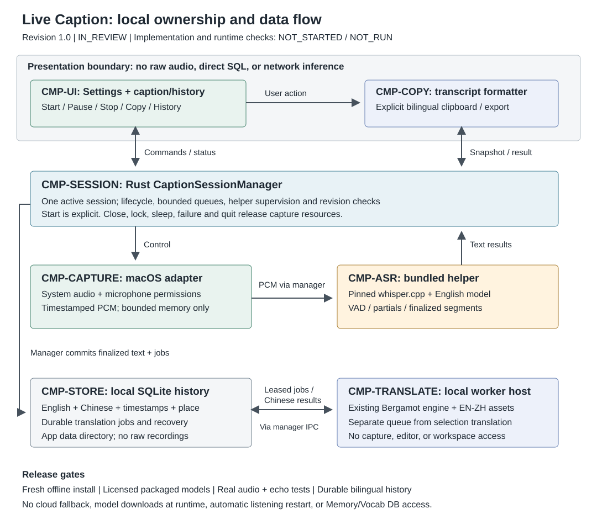

# Live Caption: offline English transcription and bilingual history

Revision: 1.0 draft, 2026-10-17 (Asia/Singapore).
Code baseline inspected: `4d437f3`.
Design: IN_REVIEW. Implementation: NOT_STARTED. Runtime verification: NOT_RUN.
This document is the feature owner; the diagram is its architectural view.

## 1. Confirmed scope and product outcome

The user confirmed English-only speech recognition, offline Chinese translation,
preservation of both languages, models included in the installer, and a copy button.
The user authorized functional design first, not feature implementation.

OBJ-01: Understand English audio without leaving the current application, and retain
a useful, private, searchable bilingual record without installing extra software.

| ID | Capability | First-release behavior |
| --- | --- | --- |
| LC-01 | Capture | System audio, microphone, or both; macOS first |
| LC-02 | Offline captions | English recognition; no Chinese speech recognition |
| LC-03 | Translation | English originals and Chinese translations, both persisted |
| LC-04 | Floating window | Movable, resizable, optionally pinned above other apps |
| LC-05 | Copy | One-click bilingual transcript copy; English/Chinese and timestamps options |
| LC-06 | History | Local sessions, timestamps, optional manually entered place, search and deletion |
| LC-07 | Export | TXT, Markdown and SRT; explicit user action only |
| LC-08 | Control | Settings toggle, pause/resume, stop, visible capture state |
| LC-09 | Distribution | Recognition and translation assets included in the installed app |
| LC-10 | Safety | No raw recording retention, automatic upload, or silent recording restart |

System audio covers audio played on this Mac, including browser media and WeChat
playback. A phone's WeChat audio is not remotely accessible; it is only audible to
the selected microphone when played nearby. DRM/protected audio and application
restrictions must produce an honest unavailable/silent-source state, not a bypass.
Room communication uses the microphone. Both mode is needed for local and remote
meeting speech, but is not speaker identification.

Not in this release: Chinese/multilingual ASR, speaker naming/diarization, meeting
summaries, agent commands, cloud inference/sync, audio recording/playback, automatic
GPS, per-application audio routing, iPhone/background system-audio capture, or a new
plugin framework. Transcripts are not automatically indexed by Memory or Vocab.

## 2. Existing implementation findings

Paths below are relative to `apps/desktop/` unless indicated otherwise.

| Inspected implementation | Implication for this feature |
| --- | --- |
| `src/app/layout/SettingsDialog.tsx` | Existing settings dialog and switch can host Live Caption controls |
| `src/shared/settings/userSettings.ts`, `useUserSettings.ts` | Version 2 preferences, validation, migration and change notifications already exist; extend, do not duplicate |
| `src/commands/appCommandRegistry.ts`, `commandState.ts`, `useAppShortcuts.ts` | Reuse command IDs, localized metadata, enablement and shortcut resolution |
| `src/shared/tauri/commandIds.ts`, `invokeTauri.ts` | Reuse typed adapter entry point and error envelope |
| `src/features/vocab/translation/offlineTranslation.ts` | `OfflineTranslation.translate()` cancels the previous selection request; its singleton is unsuitable for a continuous segment queue |
| `src/features/vocab/translation/bergamotWorker.ts`, `bundledModel.ts` | Existing local worker, abort/disposal and integrity-checked EN-ZH resources are reusable |
| `scripts/bundled-translation-assets.mjs` | Existing production verification of bundled translation files; extend the packaging pattern, not the selection lifecycle |
| `src-tauri/src/main.rs::open_new_app_window` | Spawns another executable; do not use this to create the caption panel |
| `src-tauri/src/main.rs::main` | All CloseRequested events currently enter document-close handling; caption/worker labels need explicit dispatch |
| `src/main.tsx` | Always mounts the full editor; caption and translation-host bootstraps must avoid mounting App/editor services |
| `src-tauri/capabilities/default.json` | Applies to `main` only; new windows require deliberately scoped capabilities |
| `src-tauri/src/vocab_outbox.rs::start` | Uses `app.path().app_local_data_dir()` and bundled rusqlite; follow path/storage conventions, not the Vocab database |
| `src-tauri/native/ReadingSpeech.swift`, `build.rs` | Existing Swift bridge compiles for macOS 11; new capture APIs require availability isolation, not raising the entire editor's minimum OS |
| `src/features/theme/themeTokens.ts`, `src/styles.css`, locale `.properties` files | Reuse theme tokens, Lucide icons and EN/ZH resources |
| `src/features/vocab/PassageReading.tsx` | Existing clipboard writes report success/failure; caption copying needs a transcript formatter, not document/image serialization |
| `.github/workflows/release.yml` (repository root) | Existing macOS DMG and two Rust target setup; model and helper architecture verification must join the release gates |

There is no existing Live Caption capture/ASR implementation in these paths. No
current test result establishes live recognition, mixed-audio handling, or latency.

## 3. User interaction

### Settings and activation

Add a Live Caption section to the existing Settings dialog:

- Live Caption switch: off initially; represents the native active/paused session,
  not a durable permission to start listening on launch.
- Audio source: segmented System / Microphone / Both; initial default System.
- Input device: microphone selector when applicable; never silently substitute a
  different microphone after a disconnect.
- Show Chinese translation: on initially. This changes visibility only; English
  and Chinese are still generated and stored. Label must not imply translation is off.
- Always on top: on initially; font size and last valid window bounds persist.
- History action available while capture is off; Show data folder action for discovery.

Preferences persist through the existing versioned settings mechanism. Active
capture, permission state, queue contents and session IDs are runtime state, never
localStorage configuration. On every app launch the switch is off, even when the
previous process crashed while capturing. Do not request permissions before a user
starts capture. First use explains local text storage and recording-consent responsibility.

Start sequence: validate bundled assets/storage -> check/request only the chosen
audio permissions -> open/reveal the panel -> initialize engine -> start capture.
Show each state; starting twice reveals the same session instead of duplicating it.
If initialization fails, release resources, keep the switch off, and show a specific
actionable error. Never leave audio capture running behind an error dialog.

### Caption panel

Proposed starting size 680 x 240 logical pixels, minimum 360 x 180, clamped to the
current monitor work area. These are design defaults, not measured constraints.
Remember position but recover on monitor removal, DPI changes and display zoom.
Use normal rectangular controls, restrained borders, existing tokens and <=8px radii.

Header actions, left to right: Live Caption and capture state; source selector;
Copy (Lucide Copy), Pause/Resume, History, More, Close. Tooltips and accessibility
names explain icons. At minimum width move secondary options into More; Copy,
Pause and Close stay directly available. No action depends solely on hover.

Body displays recent English sentences with corresponding Chinese below. A single
unfinished line is visually differentiated; finalized text does not jump with every
partial result. Translation has its own pending/error status and never blocks English.
Text is selectable. Auto-follow only while at the bottom; selecting text or scrolling
up suspends follow and reveals a Jump to latest action. A bounded visible tail avoids
rendering hours of text. Copy still includes the whole session, not only that tail.

Footer: elapsed time, System/Microphone activity, saved-through indicator, and
translation backlog/error status. Title/place editing is optional and never blocks
starting. No vague green Saved state while storage is failing.

Pause stops both audio sources, discards unprocessed raw buffers, and records a
pause interval; queued committed-text translation may finish. Resume requires an
explicit click and preserves the session. Source/device changes while capturing
pause first and require explicit resume; already captured source labels stay intact.
Stop or Close immediately stops acquisition, finalizes buffered speech within a
bounded deadline, commits text and ends the session. No hidden continued listening.
Esc dismisses menus, not the whole capture session. Closing the panel does not close
or save the Markdown editor. Closing the main document window cannot silently leave
capture alive: the native session is stopped before that window is destroyed.
App quit, screen lock, sleep, permission revocation, panel crash and capture-device
loss stop/pause acquisition; wake/unlock never auto-resumes.

### Copy content (LC-05)

The always-visible Copy button copies **all finalized segments of the current
session**, English then available Chinese for each segment, in chronological order.
History detail uses the same action for the selected historical session. It remains
usable while paused or after stop; disabled only when no finalized English exists.

The adjacent menu offers Bilingual (default), English only, Chinese only, and an
Include timestamps toggle (off by default). Preserve the user's copy preferences.
Normal Cmd/Ctrl+C copies only the selected text, without hijacking editor shortcuts.
Source labels can be included with timestamps in Both mode; labels are not speaker names.

Example default bilingual clipboard payload (illustrative, not recognized output):

```text
We should review the proposal tomorrow.
[The corresponding Chinese translation appears here.]

The deadline is Friday.
[The corresponding Chinese translation appears here.]
```

Copy takes a consistent persisted snapshot at click time, including translation
revisions already committed. Do not wait for future speech or unfinished translation;
do not copy unstable partial text or silently omit English. If translations are
pending, report Copied; N translations pending, allowing a later recopy. Chinese-only
mode reports omissions and is disabled if no translations are ready. Display success
only after the OS clipboard write succeeds. Failure keeps text and provides Retry.

Use `text/plain`, never raw HTML or pasted execution instructions. Copy is explicit,
never automatic on incoming audio. Format by paged database reads with a fixed
snapshot/version; long sessions cannot be silently truncated to the loaded UI page.
An initial 8 MiB clipboard safety limit rejects oversize payloads with an Export
action; no partial success. Clipboard operations may be synchronized by the user's
OS/clipboard managers; local storage privacy does not imply private clipboard delivery.

### History and exports

History is available from Settings and the panel without microphone permission or
model initialization. List title, local date/time, duration, source, optional place,
and translation completeness. Filter by date/place and search both language texts;
use bounded paging and parameterized queries. Open details without starting capture.
First release supports rename, edit place, copy, export and confirmed deletion.
Editing transcript wording is deferred; exact original recognition remains traceable.

Default title is the local start date/time; place is manually entered and empty by
default. No GPS, Wi-Fi geolocation or automatic calendar extraction. Display stored
timezone context for older sessions when the user's current timezone differs.

TXT and Markdown export use the same language options as Copy. SRT exports English,
Chinese or bilingual cues using segment-relative times, including pause intervals.
Missing Chinese is reported, not replaced with a fake translation. No original
audio exists for playback. Exports use explicit file selection and atomic writes;
they are outside the managed history retention boundary.

## 4. Ownership and architecture



| Component | Sole responsibility and state |
| --- | --- |
| CMP-UI: caption/history views | Presentation, selection, viewport and copy options; no audio buffers or database writes |
| CMP-SESSION: Rust CaptionSessionManager | One active session per app, lifecycle, authoritative status, bounded queues, sequence/revision checks and resource cleanup |
| CMP-CAPTURE: macOS capture adapter | Permissions, devices, audio format conversion and timestamps; no ASR/translation or durable recordings |
| CMP-ASR: bundled native helper | whisper.cpp recognition/VAD and streaming segment assembly; no network, user history or UI |
| CMP-STORE: CaptionStore | SQLite schema, transactions, durable finalized text, translation jobs, recovery, search and deletion |
| CMP-TRANSLATE: dedicated local worker host | Existing Bergamot engine/assets; serial caption jobs isolated from selection cancellation |
| CMP-COPY: transcript formatter/clipboard adapter | Snapshot formatting and explicit clipboard writes; no access to raw audio |

Native management is app-scoped, not bound to a document or React effect. No capture
service starts from `useEffect` mounting. UI reload reconstructs state from a snapshot
plus revisioned events; events are notifications, not a second source of truth.
Native session updates are targeted to the authorized caption/main windows, not
broadcast to every WebView. The system audio filter excludes Polarbear's own TTS
where supported; microphone acoustic pickup still needs echo handling.

### Translation reuse without lifecycle coupling

Move generic `bergamotWorker.ts`, `bundledModel.ts`, `modelManifest.json` and generic
translation errors from `features/vocab/translation` into `shared/translation` when
implementing, adjusting the existing build script/test imports together. Preserve
Vocab's latest-selection `OfflineTranslation` behavior and public reading adapter.
Do not copy the engine, download another EN-ZH model, or call its cancelling singleton
from Live Caption.

Use a dedicated local-only `caption-translator` WebView host for the existing Web
Worker. It mounts no editor, capture UI, or remote content. Rust leases committed
segment jobs to it; completion carries sessionId, segmentId, revision and leaseId.
Only matching live leases may update history. Start the host on demand; dispose it
when idle and on quit. Minimized/hidden-host scheduling must be verified on WKWebView;
if it suspends or violates latency gates, stop and revise this adapter design rather
than silently moving caption inference onto the editor thread.

On panel close, input stops immediately. Already persisted text may continue local
translation in this host while the application remains alive. At quit, unfinished
jobs remain pending; opening that history later resumes local translation, not audio
capture. Deleting a session cancels its leases before removing rows, preventing late
callbacks from resurrecting it. Translation failure never destroys English.

### Audio and inference decisions

ADR-LC-01 (PROPOSED): ScreenCaptureKit for system audio, AVAudioEngine for microphone.
Proposed Live Caption minimum is macOS 13, subject to compiled availability and
signed-package tests. Avoid macOS 15-only microphone APIs as the sole path. Preserve
the existing editor deployment baseline; unsupported systems keep editing/history
and show an unavailable caption control. Availability-gated/weak-linked capture
code must not prevent older systems from launching the app.

ADR-LC-02 (PROPOSED): whisper.cpp behind a bundled helper, initially evaluating a
quantized English `base.en` model. Alternatives are bundled `small.en` if quality
requires it, or a native in-process binding if process packaging proves unsuitable.
Apple Speech is not the default because installation/resource availability would
violate the requested out-of-box offline contract. No cloud fallback exists.

The helper is a bounded streaming adapter using the library, not repeated shell
invocations of a CLI per chunk. Launch an architecture-matched bundled executable
by absolute path and structured arguments; no PATH, Homebrew, Python, shell profile,
external ffmpeg or localhost server. Use a versioned length-prefixed binary input
protocol for PCM/control, bounded JSON result frames on stdout, and sanitized stderr.
Rust owns handshake, timeout, pipe backpressure, EOF, termination and process reaping.
Reject malformed/oversize output and stop input if the child fails. Never auto-restart
recording after a helper crash. Kill hung native inference with the helper, not the GUI.

Do not advertise fixed performance from upstream model examples. Model revision,
quantization, VAD artifact, hashes, licenses and hardware profile are implementation
gates. Ship exactly the validated English profile, not a model-choice UI.

### Streaming rules

- Capture callbacks only enqueue timestamped frames into bounded native buffers.
  Normalize to model-required PCM outside real-time callbacks. No filesystem/IPC
  blocking, React updates, translation or decoding inside an audio callback.
- Maintain continuous monotonic sample clocks per source; map them to session UTC
  anchors. System clock changes cannot reorder cues. Record gaps/source changes.
- VAD gates speech and skips silence/music where possible. English-only decoding
  does not guarantee rejection of all non-English sounds: suppress questionable
  results using validated silence/language/quality checks and document residual risk.
- Overlapping windows update one provisional segment ID. Silence, stable agreement
  or a maximum utterance duration finalizes it once. Preserve repeated real words;
  use time overlap and token alignment, not global string deduplication.
- Only finalized English is durable; enqueue its Chinese translation in the same
  database transaction. Once finalized, do not rewrite it for a later ASR partial.
- Both mode keeps source timestamps/labels, uses proven echo cancellation with
  system playback as reference, and tests headphones and speakers. Naive mixing
  or text-only deduplication is not an accepted echo strategy. The exact existing
  AEC dependency must be evaluated/pinned before claiming Both support.
- Initial proposed bounds: 20 ms capture frames, 10 s buffer per source, one
  provisional result per 500 ms, maximum 15 s utterance, two helper source states
  with bounded serial inference. These values live in feature configuration and
  require measurement; they are not product promises.
- If audio processing falls behind the buffer budget, pause capture with a visible
  gap and performance error. Never accumulate hours of audio or silently omit speech.
  Translation uses a durable queue and one in-flight job; at 60 pending segments
  pause capture with a backlog message until the user resumes. Keep all committed text.

## 5. Persistence and failure semantics

Use `app.path().app_local_data_dir()/live-caption/history.sqlite3`, never a workspace,
Vocab database or `memory.db`. On macOS with the current bundle identifier, the
expected location is `~/Library/Application Support/dev.polarbear.app/live-caption/`;
the resolver remains authoritative rather than a hardcoded path.

| Entity | Required fields |
| --- | --- |
| session | UUID, title, optional place, UTC start/end, captured timezone, status, source mode, ASR/translation profile IDs, created/updated timestamps |
| segment | UUID, session FK, stable sequence, source, start/end relative ms, finalized English, optional Chinese, translation state/error, revision |
| interval | session FK, pause/resume/source-change/gap markers with relative times and reason |
| translation_job | segment/revision unique key, state, attempts, lease ID and expiry; no audio |
| schema metadata | schema version and migration history |

`translation_state` is pending/running/ready/failed; a session ending does not mean
its translations are complete. Surface both independently. Segments and translation
jobs commit atomically; repeated results are idempotent. Label a segment saved only
after database commit; before that it is visibly saving. On storage-full, permission
failure or broken database, stop acquisition and preserve a bounded unsaved text
snapshot for Copy/Export. Do not claim it will survive a crash.

Use bundled rusqlite on a single serialized storage worker, foreign keys, WAL and
appropriate durable commit settings; no synchronous SQLite work on UI/capture
threads. Back up before schema migration, reject future schema versions, and never
replace an unreadable database with an empty one. Search may start with paged SQL
queries; add FTS only if measured history search requires it. UI sorting uses stable
timestamps and IDs; offset-independent cursors prevent duplicate/missing pages.

After crash, mark previously active sessions interrupted, expire job leases, retain
committed segments, and show an interruption marker. Unfinalized words/audio may be
lost; never synthesize missing words. On restart do not record; an explicit history
open can retry text translation. Only successful persistence advances the saved watermark.

Retain history until the user deletes it. No arbitrary TTL for transcripts. Show
disk usage and deletion/export controls; full disk causes a visible stop. Files use
user-only permissions where supported and are not encrypted by this feature; OS
disk encryption/backups are separate concerns. Clear session/all history with
confirmation, including jobs and managed backups; explain external exports and OS
backups remain. Logical deletion is not guaranteed forensic erasure on SSDs.

## 6. State, IPC, commands and configuration

Session state: idle -> preparing -> listening <-> paused -> stopping -> ended.
Preparing failure returns idle with an error. Runtime failure stops resources and
marks the session interrupted; never imply recording is still active. Permission
and device availability are separate inputs, not persisted booleans.

Every mutating control includes an operation ID for idempotency and an expected
session ID/generation. Duplicate start/pause/stop and rapid toggle sequences cannot
create duplicate sessions or reactivate a stopped generation. Stop/close wins over
pending start authorization; late permission callbacks must not start capture.

Proposed typed Tauri surface (centralize strings in existing commandIds):

| Operation | Contract |
| --- | --- |
| caption_get_status | Supported sources, permission/asset states, active session and revisions |
| caption_start / pause / resume / stop | Validated IDs, source/device selection; return authoritative snapshot |
| caption_list_sessions / get_segments | Cursor/filter request; bounded pages with continuation |
| caption_update_session / delete_session | Title/place update or confirmed deletion; no arbitrary filesystem path |
| caption_copy / export | Session, language, timestamps and snapshot revision; return complete/pending/error counts |
| caption_translation_claim / complete | Private translator-window lease protocol, strict origin/window validation |

Use one `APP_EVENTS.captionChanged` notification with typed discriminated payloads
for lifecycle, volatile partials, persisted segment changes and errors. Include
session/generation/revision so clients can reject stale events and refresh snapshots.
Native handlers must validate the calling window label. Capability JSON alone does
not automatically restrict every custom Tauri command; explicitly constrain caption
and translator commands with permissions and handler checks. Translator never gets
workspace/Vocab/Memory/clipboard or generic shell access. Include existing application
commands in the scoped permission manifest, or enforce equivalent caller checks;
restricting only the new caption commands leaves existing custom commands exposed.
Add negative tests that invoke workspace, Vocab and Memory commands from the
translator window and require rejection. Do not loosen global CSP;
load packaged resources only, with navigation denied to remote pages.

App commands: `caption.toggle`, `caption.pauseResume`, `caption.stop`,
`caption.copy`, `caption.history`, `caption.export`. Reuse registry/state/dispatch;
toggle.checked is native session state, copy.enabled requires finalized content.
No new global shortcut by default. All commands have visible mouse/touch entrances;
normal text selection retains Cmd/Ctrl+C. Window-specific command handling must not
send caption commands into CodeMirror or intercept editor save/undo.

Settings v3 migration preserves all existing preferences and adds caption source,
selected input device, showTranslation, alwaysOnTop, fontSize, window bounds and
copy preferences. Do not persist active/listening state. Use existing settings
notifications plus cross-window synchronization, not another settings store.
Validate/reconcile preferences at startup and on display/device changes.

Add `caption.*` keys to existing English and Chinese `.properties` files for
controls, states, permissions, source labels, copy outcomes, export, history and
errors. UI language does not change ASR language. Use structured errors including
permissionDenied, unsupportedPlatform, modelMissing, modelInvalid, inputUnavailable,
engineFailed, inferenceTimeout, audioBacklog, translationFailed, storageFailed,
clipboardFailed and exportFailed. Internal error codes are not translated prose.

## 7. Scoped implementation map (proposed; no directories created yet)

| Location | Change and boundary |
| --- | --- |
| `src/features/caption/` | Panel, history, feature hook, DTO/model, adapter, transcript formatting and tests; split only by actual responsibility |
| `src/shared/translation/` | Move reusable engine/assets loader; leave selection-specific scheduling with Vocab |
| `src/app/layout/SettingsDialog.tsx` | Embed caption settings/status, not the capture engine |
| `src/main.tsx` | Explicit lightweight caption and translator entry selection by native window label |
| Existing command/settings/event/i18n files | Extend the existing contracts and validation; no parallel registry |
| `src-tauri/src/live_caption/` | Manager, store, DTOs, helper protocol and macOS adapter ownership |
| `src-tauri/native/LiveCaptionAudio.swift` | Availability-gated native capture and lifecycle bridge |
| `src-tauri/native/caption-engine/` | Minimal bundled helper build using pinned whisper.cpp; no recognition algorithm reimplementation |
| `src-tauri/src/main.rs` | Register manager/commands; label-aware close/exit cleanup only |
| `src-tauri/build.rs`, bundle resources/capabilities | Native integration, permission descriptions, helper/model packaging |
| `scripts/` and existing release workflow | Integrity, license, architecture, offline packaged-app and resource gates |

No changes to Markdown serialization, table behavior, Git/cloud sync, Memory storage
or the Vocab learning engine. Future platforms implement capture/permission adapters
only after separate design. iOS cannot inherit macOS arbitrary system-audio promises.

## 8. Packaging and offline guarantee

Both ASR and EN-ZH inference must work on first launch with networking blocked and
no Apple language packs, development tools, external runtime or prior model cache.
Whisper model and any VAD model are native bundle resources; translation continues
using the existing packaged Bergamot resources. Do not place large ASR assets in
the JS bundle or load them into the editor WebView.

Add a manifest recording engine commit/version, format, language, quantization,
file sizes, SHA-256 hashes, original source and licenses. Pin build inputs and
verify artifacts before packaging and before first use. Missing/corrupt assets fail
the build or yield Repair installation at runtime; no runtime download fallback.
Build-time artifact acquisition is explicit, checksum-pinned and reproducible.
Review licenses for converted/quantized weights and VAD assets, not just engine code.

Build helper slices for each shipped architecture and verify the executable and
resource layouts inside the final .app/DMG. Include dependent dylibs/Metal assets
when required. Preserve the project's distribution/signing policy; verify the final
helper with that policy and do not claim notarization if the artifact is unsigned.
No generic shell permission is exposed to WebViews. Check installed-app TCC identity
and privacy descriptions, not only a development executable launched from Terminal.

## 9. Delivery plan, acceptance and evidence

Implementation authorization remains separate from this design review. Stages are
dependency-ordered work packages, not separate claims that the feature is finished.

| Stage | Deliverable | Completion gate |
| --- | --- | --- |
| D0 | Pin ASR/VAD/AEC artifacts; verify system/microphone capture feasibility | Offline model quality, echo and old-OS launch evidence; revise ADR if unsuitable |
| D1 | Session manager, store, recovery and protocol | Deterministic lifecycle, migration, deletion and crash tests |
| D2 | Packaged capture/helper and provisional/final subtitles | Real browser/WeChat/microphone/Both acceptance; editor remains responsive |
| D3 | Isolated existing translation worker and durable queue | Parallel reading translation, close/quit recovery and stale result tests |
| D4 | Settings, panel, Copy, history and exports | EN/ZH, keyboard, light/dark, zoom/monitor and clipboard validation |
| D5 | Installed-app offline release gate and documentation | All mandatory gates PASS; blockers are never relabeled PASS |

| Gate | Acceptance and evidence required | State |
| --- | --- | --- |
| QG-01 / LC-01,08,10 | Permissions only after Start; deny/revoke/cancel races; lock/sleep/disconnect/close/quit stop capture; no restart recording | NOT_RUN |
| QG-02 / LC-01,02 | Browser video, WeChat playback, quiet room, headset and speaker meetings; no duplicate echo captions; unsupported audio reported | NOT_RUN |
| QG-03 / LC-02,03,09 | Fresh packaged install with network blocked, no Apple language packs/model cache; English and Chinese work | NOT_RUN |
| QG-04 / LC-02 | Annotated English fixtures, accents/names/numbers, silence/music/non-English, chunk overlaps and sustained speech; record WER and hallucinations | NOT_RUN |
| QG-05 / LC-03,06,10 | Fault injection for disk-full, transaction failure, crash, helper kill, leases, deletion and schema migration; committed text survives | NOT_RUN |
| QG-06 / LC-05,07 | Copy during updates, pending Chinese, selected-text copy, empty/long history, clipboard denial, timestamped exports and segment order | NOT_RUN |
| QG-07 / LC-04,08 | 360px width, light/dark, EN/ZH, VoiceOver, reduced motion, multiple monitors, zoom, full-screen apps and focus; no editor key hijack | NOT_RUN |
| QG-08 / LC-02,03 | One-hour authorized fixture session on declared Apple Silicon/Intel profiles; bounded memory/queues, latency and responsive typing | NOT_RUN |
| QG-09 / LC-09,10 | Model hashes/licenses, helper architectures, privacy descriptions, scoped commands, no content in logs/network; package inspection | NOT_RUN |
| QG-10 / regression | Desktop typecheck/lint/unit/build/Rust checks; selection translation, Vocab, editor save/undo and native clipboard regressions | NOT_RUN |

Proposed performance acceptance targets, not measured promises: on each advertised
hardware profile, p95 first partial <=3 s from speech start, finalized text <=5 s
after speech ends, and Chinese <=5 s after English commit for ordinary sentences.
Quality starting targets: WER <=15% for clean conversational English and <=25% for
the labeled meeting/accent suite; no finalized text on the designated silent clips.
Freeze corpus, hardware, engine/model hashes and measurement definitions before D0;
report per-source results and unsupported profiles rather than averaging away failures.
Translation must preserve meaning of negatives, dates and numbers in human-reviewed
fixtures; failures remain visible. These gates may require a larger bundled model.

Real audio acceptance uses consented/licensed fixtures, not ambient recording of
unaware participants. Browser mocks do not establish OS capture or engine performance.
After failure, record environment, artifact and reproduction before changing gates.
No live listening or long-running performance test is authorized by this document alone.

Design-artifact checks on 2026-10-17: local Markdown links verified; SVG XML parsed
successfully and its Chromium rendering visually inspected; `git diff --check`
passed. These checks apply only to documentation, not any runtime acceptance gate.

## 10. Decisions and unresolved implementation gates

Confirmed requirements: English ASR; Chinese translation saved alongside; offline;
installer-owned models; copy button; settings activation; local history. Recommended
design decisions awaiting review: default-off capture, system source default,
text-only history, manual place, copy defaults, native session owner, helper isolation,
and scoped model/translation extraction.

Open technical gates do not require users to pick libraries: exact ASR/VAD/AEC
revisions and licenses; validated hardware/OS matrix; helper signing/package layout;
hidden WKWebView translation scheduling; Both-mode echo quality. They must be
resolved with evidence before implementation is called complete. First-release
acceptance includes Both mode; do not silently remove it to pass a release gate.

## References (checked 2026-10-17)

- [Apple ScreenCaptureKit capture sample](https://developer.apple.com/documentation/screencapturekit/capturing-screen-content-in-macos): system audio/capture integration reference; not a test of Polarbear.
- [Apple capturesAudio](https://developer.apple.com/documentation/screencapturekit/scstreamconfiguration/capturesaudio): audio capture configuration reference.
- [whisper.cpp](https://github.com/ggml-org/whisper.cpp): offline ASR, hardware backends, quantized model and VAD capabilities. Streaming examples require application-level reliability work.
- [whisper.cpp license](https://github.com/ggml-org/whisper.cpp/blob/master/LICENSE) and [Whisper license](https://github.com/openai/whisper/blob/main/LICENSE): provenance inputs; final redistributed artifact notices still require review.
- [Tauri external binaries](https://v2.tauri.app/develop/sidecar/): bundled executable and target-specific packaging conventions.
- [Tauri capabilities](https://v2.tauri.app/security/capabilities/): per-window permissions and custom-command boundary considerations.
