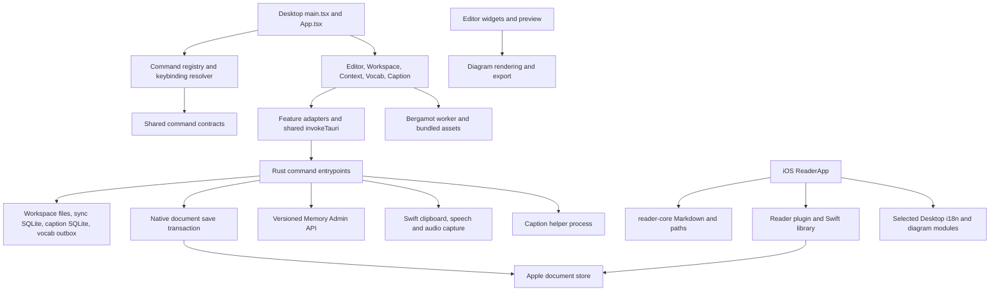

# Architecture Audit

## Scope and baseline

Audit base: `22d9e0b`, branch `codex/caption-streaming`. The six pre-existing Feedback changes in App, ActivityRail, product configuration, both locales and memory.css are excluded from this refactoring. No dependency upgrade or persistent format migration is performed. Two already-resolved libraries gain explicit Desktop dependency declarations.

The tracked inventory contains 390 Desktop files, 55 iOS files, 11 package files and five workflows at baseline. Inspection covers source layout, package/build manifests, static TypeScript imports, representative native and UI ownership paths, dynamic asset registration, tests and CI. This is a repository-wide structural audit with targeted behavioral verification, not a claim that every line or native environment has been exercised.

Baseline checks executed before production edits: Desktop TypeScript and ESLint passed; Desktop Vitest 47 files / 238 tests passed; iOS Vitest 4 files / 36 tests passed. Subsequent validation is recorded in [the execution report](refactoring-report.md).

## Current architecture

- `apps/desktop/src/main.tsx` / `App.tsx`: composition plus document/tab state, file operations, zoom, commands and dialogs. App has 4,334 lines at baseline; the risk is shared responsibilities, not line count alone.
- `features/editor/components/TyporaLiveEditor.tsx`: 3,179 lines; CodeMirror widgets, document mapping and interaction. Existing table model/commands already provide useful separation.
- `commands/`: command identity/state, platform accelerators, conflict resolution and native menu. Retain this system; do not add a parallel event bus.
- `shared/settings/userSettings.ts`: canonical user preferences; legacy keys are migration inputs, not higher-priority settings. `ContextWorkspace` uses the Engine config, not localStorage. Workspace is the default launch surface, not the last Context page.
- `src-tauri/src/main.rs`: 3,613 lines spanning composition, native menus, filesystem and repository operations. `memory_admin`, `live_caption`, `vocab_outbox` and secret storage are already separate owners.
- `apps/ios`: intentionally separate Cargo project and imported-document library. It is not added to the Desktop build target. Selected Desktop imports are guarded by `reader/boundaries.test.ts`.
- `packages/reader-core`: Markdown rendering and confined relative paths, exercised by iOS tests. `packages/apple-document-store`: grants, coordinated writes, draft journal and conflict recovery; compiled through Swift package and Desktop build script.

## Dependency evidence

A TypeScript AST scan over tracked TS/TSX source imported relative modules, re-exports and literal dynamic imports: **no relative-import cycles found**, 21 cross-feature edges at baseline. This does not resolve computed imports, IPC strings, CSS or package export cycles. Editor-to-Diagram and Vocab-to-shared-translation are deliberate adapters, not automatically illegal dependencies.

Dynamic roots reviewed before deletion decisions:

| Root | Evidence / treatment |
| --- | --- |
| Desktop main and caption HTML | `vite.config.ts` explicitly builds both; retain hidden translator entry |
| Locale files | `shared/i18n/translate.ts` eagerly loads `locales/*.properties`; zero TS imports do not imply unused |
| Native commands | `main.rs` invoke handler and shared `commandIds.ts`; inspect both sides before removal |
| Swift / caption helpers | `src-tauri/build.rs`, `scripts/build-caption.mjs` and release workflow select/compile them |
| Engine contracts | `scripts/generate-memory-admin-contract.mjs` owns generated Admin types; retain vendored source and check |
| Caption candidate engines | Qualification workflows/scripts select research paths; not dead because not production default |
| Model/icon assets | Vite translation plugin, Tauri bundle configuration and caption manifest are runtime references |

No source file, model, locale, compatibility migration or dependency was proven dead enough to delete wholesale. The rollup dev dependency is not removed merely because code does not import it: build-resolution/security pin intent requires separate review. Tracked IDE metadata is non-product debt, not a reason to delete local user settings.

## Confirmed findings

1. **Cross-workspace completion:** `useContextOsSession.run` accepted results from previous workspace operations; `updateConfig` then wrote them into current React state. A delayed save to A, switch to B, finish A reproduces the wrong config. Separately, either of two concurrent operations set `isMutating=false` before the other finished. Both reproduced in Playwright before fixes.
2. **Disposed revision callback:** `useWorkspaceDocumentRevision.checkRevision` checked `disposed` only before await. Cleanup during native metadata read still invoked `onMissing`; a deferred-promise test failed before the fix.
3. **Unbounded rendered diagrams:** `diagramPreviewWidgets.ts` retained source, SVG and localized error for every distinct source for the lifetime of the module, twice duplicating pending/completed map logic. Failed remote results stayed cached indefinitely. Bound successful retained strings and share cache policy; leave renderer/consent differences intact.
4. **Invisible operation feedback:** `App -> AppShell -> Sidebar` passed `statusMessage`, but Sidebar never rendered it. Many filesystem and clipboard catch paths only update that state. This is a broken presentation path, not an unused business state to delete.
5. **Reader persisted-data trust:** `readingState.readPositions` cast any JSON object to valid positions. `savePosition` sorts every value using `.openedAt`; a `null` record can throw and prevent all subsequent saves. Filter invalid entries at the storage boundary without dropping valid history.
6. **Cross-project draft:** `ContextWorkspace` can receive another workspace without being unmounted. Its Settings child retained the previous project's draft. A real React browser test reproduced this. The exported boundary now keys the complete session UI by workspace, including draft, selection and child requests.
7. **Implicit dependency ownership:** Desktop directly imports `lucide-react` and `@codemirror/language` without declaring them. Hoisting from iOS/transitive packages masked the missing declarations. The fix retains resolved versions 0.468.0 and 6.12.3; a source-AST test checks all three npm workspaces and manifest/lock agreement.
8. **Dead UI styles:** `.plugin-list`, `.plugin-status` and its enabled/planned variants appear only in `styles/base.css`, with no matching JSX, DOM construction or test fixture. These five selectors are removed. Other grouped sidebar selectors are left intact rather than bulk-deleting similar-looking CSS.

## Risks requiring separate protection

- Native save risks were reproduced and addressed in follow-up batch F. `document_save::save` now owns serialized/coordinated version checking, staging, macOS metadata preservation, final recheck and publication. See [the owning save contract](file-save-safety.md) for cooperative-writer guarantees and the remaining non-cooperating writer/power-loss limits.
- A pending frontend save also cleared dirty state for newer input, and Save As replaced that input with its older snapshot. Browser regressions now protect snapshot-aware acknowledgment and identity transitions. Full App document-session extraction remains separate work.
- `App::selectFile` previously updated active tab state before load success. Batch I reproduces and fixes the phantom-tab path, adds window-local `DocumentNavigation` result acceptance, and protects workspace replacement from unsaved drafts. Full buffer/session ownership across external reload, rename and Save As remains a separate task.
- At baseline, `useNativeAppMenu` rebuilt native objects without explicit disposal. Batch K verifies Tauri handle ownership, replaces separately allocated check items with inline options, releases returned handles and coalesces installations. Mocked lease counts are covered; installed native RSS is not measured.
- At baseline, `tableLayoutState` was module-global without document disposal. Batch L reproduces cross-document contamination and offset loss, then moves widths into CodeMirror session state with position mapping, generation isolation and structural undo effects. See [menu and table lifetimes](menu-table-lifetimes.md).
- Repository progress registration failures now reach the existing localized status surface, and disposed registrations cannot deliver stale progress. This was reproduced before the batch G fix; sync success/failure remains owned by the operation, not the progress subscription.
- Caption ingress is bounded, first failure seals the epoch, and `EngineProcess::drop` kills/reaps the helper. These protections must remain. This audit does not requalify ASR accuracy, latency, Intel/ARM parity or microphone permission behavior.
- iOS import/read flows and Desktop localStorage updates have separate concurrency concerns. Do not merge native document coordination and simple UI preferences into one generic storage service.

## Target architecture and pattern review

Retain a feature-based modular application, not mandatory MVVM/DDD layers. App remains the composition root; move independently testable policies to their feature owners only when evidence justifies it.

| Problem | Pattern decision | Ownership / compatibility |
| --- | --- | --- |
| Context results outlive workspace | Small session lifetime owner | Epoch and in-flight count; no remote rollback claim, no persistent format change |
| Duplicate diagram caching | Feature cache policy | Pending deduplication and bounded successful strings; renderer consent and error localization remain outside |
| Invalid reading positions | Boundary parsing | Existing storage key/shape and 500-entry cap retained |
| Lost feedback | Complete existing presentation path | No new notification bus or parallel status store |
| Save commit versus sync bookkeeping | Explicit partial-success DTO | The committed revision remains authoritative; optional queue warning does not claim remote delivery |
| Sync preflight | Feature use case reusing saveTab | No duplicate IO, dirty-state owner or retry loop; batch snapshots protect intervening edits |
| Superseded file reads | Window-local navigation intent owner | Reject stale UI application, do not pretend native IO was cancelled; no persisted navigation store |
| Large App/native main | Defer guarded extraction | First protect file open/save/close and zoom behavior; no mechanical line-count splits |
| Platform differences | Retain feature adapters | No service interface per simple function; no mobile filesystem assumptions added |

The target dependency direction remains UI -> feature use case/policy -> adapter -> native API. Shared contracts must not import app/feature implementations. Desktop never accesses Memory Engine database storage directly. Performance improvements are not claimed from code cleanup or a successful build.
